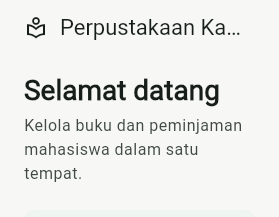

# Dokumentasi hasil program

Folder ini mencatat hasil pemeriksaan aplikasi Sistem Perpustakaan Kampus.

## Tampilan aplikasi

Berikut tangkapan layar aplikasi yang berjalan di browser.

## Fitur yang berjalan

- Katalog menampilkan judul, penulis, jumlah salinan, dan ketersediaan buku.
- Pencarian dapat mencocokkan judul atau nama penulis.
- Peminjaman mencatat NIM, tanggal pinjam, dan jatuh tempo 14 hari kemudian.
- Peminjaman ditolak jika salinan tidak tersedia atau mahasiswa yang sama masih memiliki pinjaman aktif untuk judul tersebut.
- Pengembalian menambah jumlah salinan yang tersedia dan memperbarui catatan pinjaman.
- Daftar pinjaman dapat difilter berdasarkan status dan menampilkan tanggal jatuh tempo serta tagihan.
- Ringkasan menampilkan jumlah judul, jumlah salinan tersedia, pinjaman terlambat atau hilang, dan total tagihan.
- Denda Rp5.000 dikenakan untuk setiap minggu penuh setelah tanggal jatuh tempo.
- Pada batas enam bulan kalender, status pinjaman menjadi hilang. Tagihan mencakup harga penggantian buku dan denda enam bulan sebesar Rp130.000.
- Mengembalikan buku yang sudah berstatus hilang tidak menghapus tagihannya.
- Tombol pengembalian membuka pemilih tanggal supaya denda keterlambatan dapat diuji dengan tanggal pilihan, termasuk simulasi sampai batas enam bulan.

## Mencoba ringkasan denda

Pinjam sebuah buku, lalu pilih **Kembalikan** pada catatan pinjamannya. Pada kalender, pilih tanggal tujuh hari setelah jatuh tempo untuk melihat denda Rp5.000, lalu konfirmasi tanggal tersebut. Nilai denda akan terlihat di kartu **Total tagihan** bagian atas serta pada catatan buku yang sudah dikembalikan. Kalender mengizinkan simulasi hingga tanggal batas enam bulan setelah jatuh tempo.

## Hasil pemeriksaan

`flutter test` berhasil dengan 10 tes yang mencakup aturan pinjam, stok, tanggal jatuh tempo, denda, batas enam bulan, pengembalian, dan UI. `flutter analyze` selesai tanpa temuan.

Tes batas denda memeriksa hari jatuh tempo, minggu keterlambatan pertama dan kedua, serta tanggal kalender enam bulan. Tes pengembalian memastikan tagihan tetap ada setelah buku berstatus hilang dikembalikan.

## Cara menjalankan

Dari folder utama project, jalankan `flutter run -d chrome` atau `flutter run -d windows`. Data contoh hanya berada di memori dan akan kembali ke kondisi awal setelah aplikasi ditutup.
